# corrode

Fast JPEG+RAW photo culling in the terminal, with RawTherapee integration and glitch effects. Written in Rust.

> Status: early development. Culling, sorting a selection into groups of similar shots and applying a preset in bulk work; the effects are still a library, without an interface yet.

## Gallery

Every picture is the same photo, cropped to a square, with one effect; open `recipe and options` under it for the recipe that made it and the parameters of the effect. What each effect does is [explained below](#effects), and `sh docs/examples/generate.sh` makes the pictures again.

<!-- gallery:start -->
<table width="100%">
<tr><td width="33%" align="center" valign="top">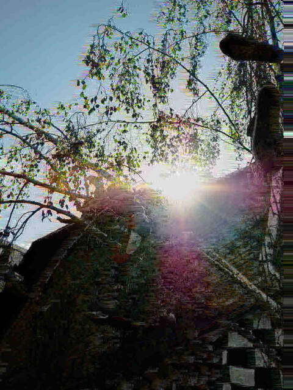<br><b>generation loss</b><details><summary>recipe and options</summary><div align="left"><code>loss</code><br><br><code>generations=30</code> times the picture is saved as a JPEG and read back<br><code>quality=25</code> JPEG quality of each generation, 1 to 100; the lower, the faster it wears<br><code>shift=1,0</code> <code>dx,dy</code>: pixels the picture moves before each generation, so that the blocks do not line up<br></div></details></td><td width="33%" align="center" valign="top">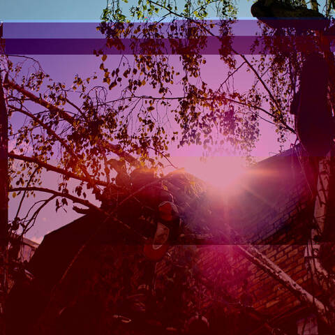<br><b>databending</b><details><summary>recipe and options</summary><div align="left"><code>bend</code><br><br><code>quality=75</code> JPEG quality before the bytes are bent; the lower, the larger the blocks<br><code>hits=8</code> how many bytes of the file are changed<br></div></details></td><td width="33%" align="center" valign="top">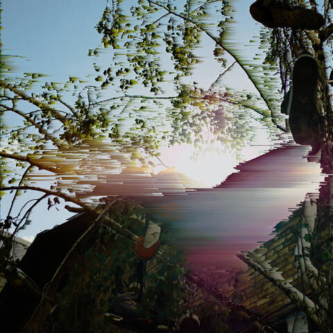<br><b>pixel sorting</b><details><summary>recipe and options</summary><div align="left"><code>sort</code><br><br><code>direction=horizontal</code> <code>horizontal</code> or <code>vertical</code><br><code>low=40</code> darkest brightness that is sorted, 0 to 255<br><code>high=220</code> brightest brightness that is sorted, 0 to 255<br><code>reverse=false</code> sort from bright to dark instead<br></div></details></td></tr>
<tr><td width="33%" align="center" valign="top">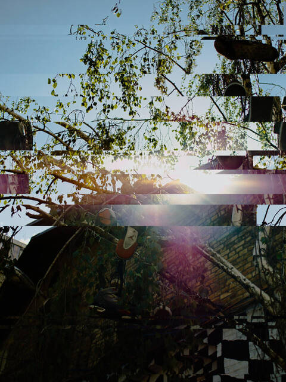<br><b>slice shift</b><details><summary>recipe and options</summary><div align="left"><code>slice</code><br><br><code>slices=12</code> how many slices are pushed aside<br><code>shift=120</code> how far a slice can go, in pixels<br><code>height=8,120</code> <code>min,max</code> height of a slice, in pixels<br><code>split=false</code> push red, green and blue by different amounts, so that they come apart<br><code>invert=false</code> invert the colours of one slice in three<br></div></details></td><td width="33%" align="center" valign="top">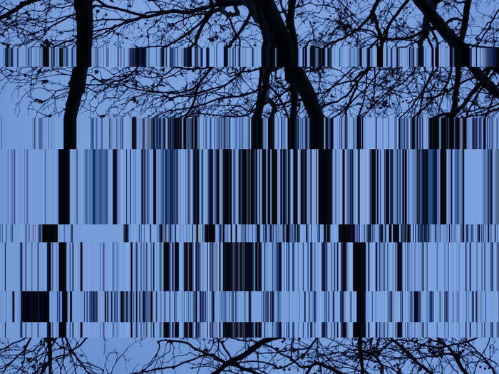<br><b>pixel stretch</b><details><summary>recipe and options</summary><div align="left"><code>stretch</code><br><br><code>bands=6</code> how many lines are stretched<br><code>length=20,200</code> <code>min,max</code> how far a line is stretched, in pixels<br><code>direction=horizontal</code> <code>horizontal</code> (rows) or <code>vertical</code> (columns)<br></div></details></td><td width="33%" align="center" valign="top">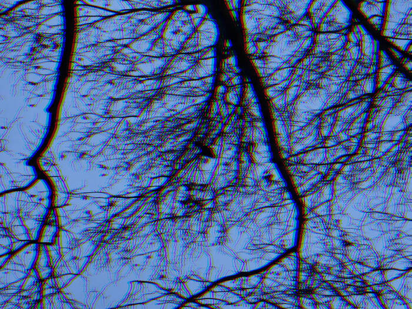<br><b>channel split</b><details><summary>recipe and options</summary><div align="left"><code>split</code><br><br><code>red=-6,0</code> <code>dx,dy</code> pixels the red channel moves<br><code>green=0,0</code> <code>dx,dy</code> pixels the green channel moves<br><code>blue=6,0</code> <code>dx,dy</code> pixels the blue channel moves<br></div></details></td></tr>
<tr><td width="33%" align="center" valign="top">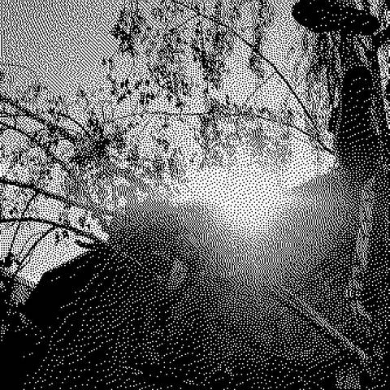<br><b>dither, error diffusion</b><details><summary>recipe and options</summary><div align="left"><code>dither</code><br><br><code>method=diffusion</code> <code>diffusion</code> (scattered dots) or <code>bayer</code> (regular pattern)<br><code>size=2</code> size of a dot, in pixels<br><code>mid=128</code> brightness, 0 to 255, that comes out mid-grey<br></div></details></td><td width="33%" align="center" valign="top">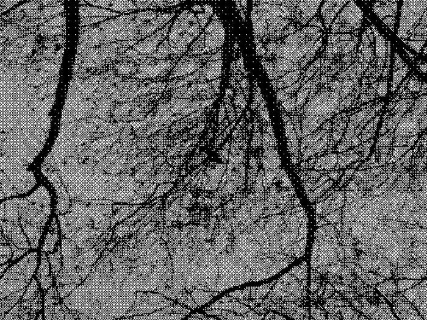<br><b>dither, ordered matrix</b><details><summary>recipe and options</summary><div align="left"><code>dither method=bayer</code><br><br><code>method=diffusion</code> <code>diffusion</code> (scattered dots) or <code>bayer</code> (regular pattern)<br><code>size=2</code> size of a dot, in pixels<br><code>mid=128</code> brightness, 0 to 255, that comes out mid-grey<br></div></details></td><td width="33%" align="center" valign="top">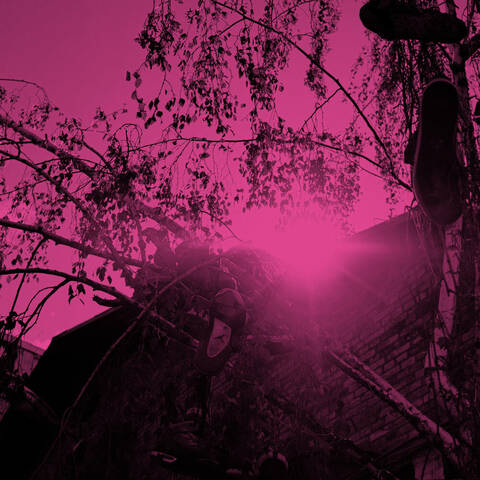<br><b>duotone</b><details><summary>recipe and options</summary><div align="left"><code>duotone</code><br><br><code>dark=000000</code> ink of the shadows; a colour is hex, a name or a hue<br><code>light=ff4fa3</code> ink of the lights<br></div></details></td></tr>
<tr><td width="33%" align="center" valign="top">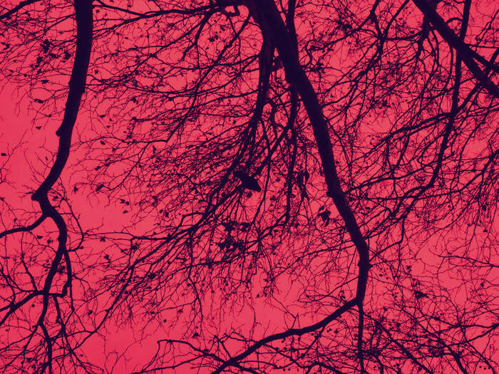<br><b>tritone</b><details><summary>recipe and options</summary><div align="left"><code>tritone</code><br><br><code>dark=14052b</code> ink of the shadows<br><code>mid=e0204f</code> ink of the mid tones<br><code>light=ffd9a0</code> ink of the lights<br><code>mix=100</code> how much of the print shows over the picture, 0 to 100<br></div></details></td><td width="33%" align="center" valign="top">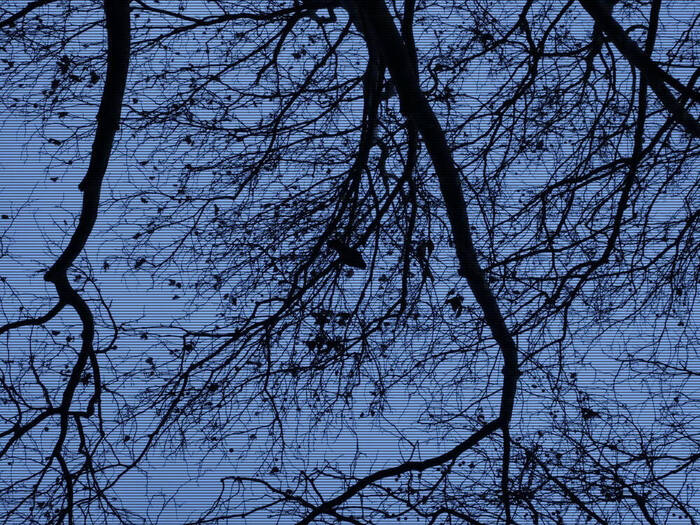<br><b>scanlines</b><details><summary>recipe and options</summary><div align="left"><code>scanlines</code><br><br><code>period=4</code> rows from one line to the next<br><code>thickness=1</code> rows a line is thick<br><code>strength=60</code> how dark the lines are, 0 to 100<br></div></details></td><td width="33%" align="center" valign="top">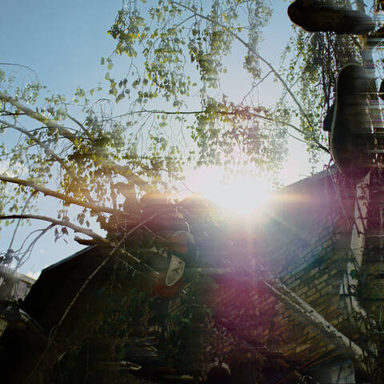<br><b>drag, a flash over a slow shutter</b><details><summary>recipe and options</summary><div align="left"><code>drag</code><br><br><code>kind=motion</code> <code>motion</code> (along a line) or <code>zoom</code> (from the centre)<br><code>length=60</code> how far the smear goes, in pixels<br><code>angle=0</code> direction of a motion smear in degrees, 0 to the right, 90 down<br><code>mix=70</code> how much of the smear shows, 0 to 100<br><code>blend=lighten</code> <code>lighten</code>, <code>screen</code> or <code>normal</code><br></div></details></td></tr>
<tr><td width="33%" align="center" valign="top">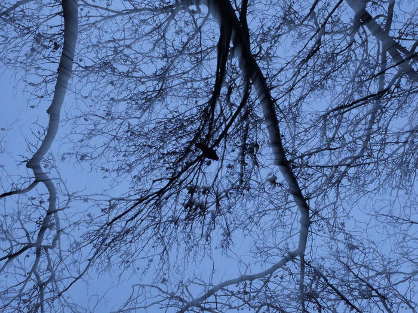<br><b>drag, zooming</b><details><summary>recipe and options</summary><div align="left"><code>drag kind=zoom</code><br><br><code>kind=motion</code> <code>motion</code> (along a line) or <code>zoom</code> (from the centre)<br><code>length=60</code> how far the smear goes, in pixels<br><code>angle=0</code> direction of a motion smear in degrees, 0 to the right, 90 down<br><code>mix=70</code> how much of the smear shows, 0 to 100<br><code>blend=lighten</code> <code>lighten</code>, <code>screen</code> or <code>normal</code><br></div></details></td><td width="33%" align="center" valign="top">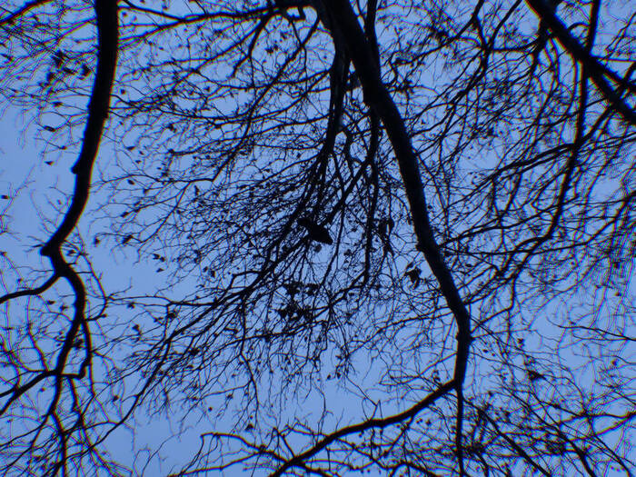<br><b>chromatic aberration</b><details><summary>recipe and options</summary><div align="left"><code>aberration</code><br><br><code>amount=0.006</code> how much larger the red is drawn than the green, and the blue smaller; 0.01 is already strong<br></div></details></td><td width="33%" align="center" valign="top">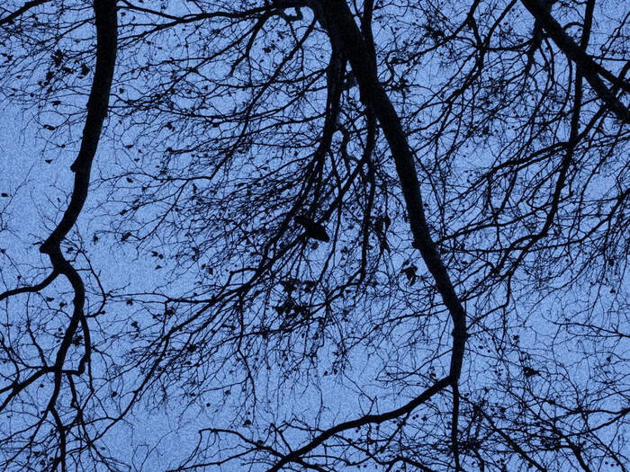<br><b>film grain</b><details><summary>recipe and options</summary><div align="left"><code>grain</code><br><br><code>strength=30</code> how strong the grain is, 0 to 100<br><code>size=2</code> size of a grain, in pixels<br><code>color=false</code> grain that colours the picture, or only lightens and darkens it<br></div></details></td></tr>
<tr><td width="33%" align="center" valign="top">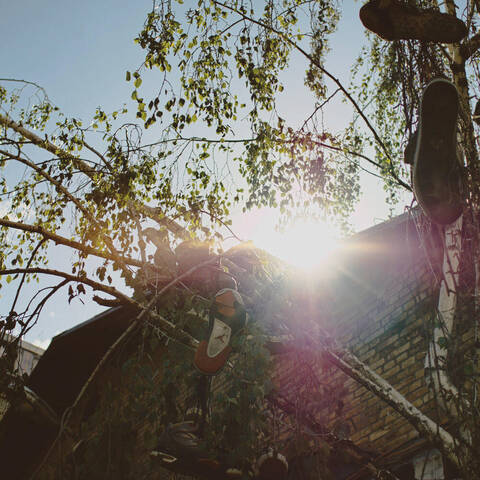<br><b>faded print</b><details><summary>recipe and options</summary><div align="left"><code>fade</code><br><br><code>lift=12</code> how far the blacks are lifted, 0 to 100<br><code>saturation=80</code> 100 leaves the colour, 0 takes it out, 200 doubles it<br><code>tint=ff8c42</code> colour the picture leans towards<br><code>tint_amount=10</code> how much it leans, 0 to 100<br></div></details></td><td width="33%" align="center" valign="top">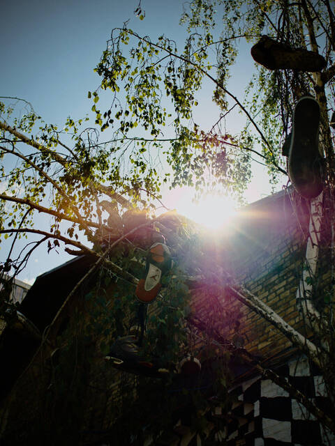<br><b>vignette</b><details><summary>recipe and options</summary><div align="left"><code>vignette</code><br><br><code>strength=50</code> how dark the corners get, 0 to 100<br><code>start=40</code> where the darkening starts, 0 to 100 of the way from the centre to the corners<br></div></details></td><td width="33%" align="center" valign="top">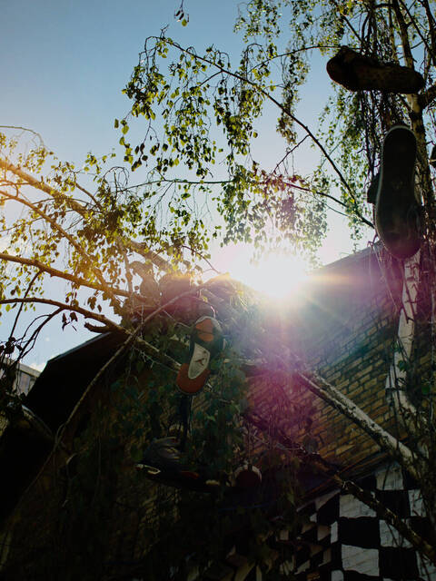<br><b>light leak</b><details><summary>recipe and options</summary><div align="left"><code>leak</code><br><br><code>color=ff963c</code> colour of the light<br><code>strength=70</code> how strong the leak is, 0 to 100<br><code>size=50</code> how far it reaches, 0 to 100 of the width<br></div></details></td></tr>
<tr><td width="33%" align="center" valign="top"><br><b>bloom</b><details><summary>recipe and options</summary><div align="left"><code>bloom</code><br><br><code>threshold=200</code> brightness above which a light glows, 0 to 255<br><code>radius=30</code> how far the glow spreads, in pixels<br><code>strength=60</code> how bright the glow is, 0 to 100<br></div></details></td><td width="33%" align="center" valign="top">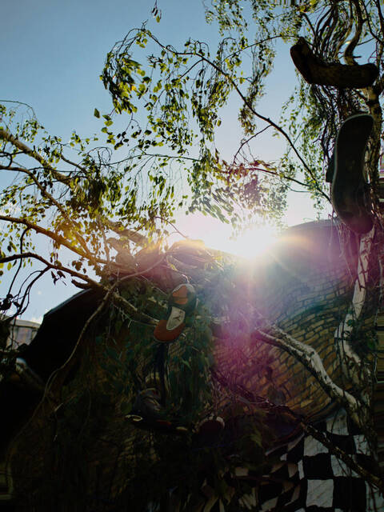<br><b>liquid distortion</b><details><summary>recipe and options</summary><div align="left"><code>liquid</code><br><br><code>amplitude=40</code> how far a pixel can be pushed, in pixels<br><code>scale=150</code> size of the waves, in pixels<br><code>octaves=2</code> layers of finer waves; 1 is smooth, 3 is choppy<br><code>drift=0</code> how far the waves have drifted, in pixels; moving it makes the water flow<br></div></details></td><td width="33%" align="center" valign="top">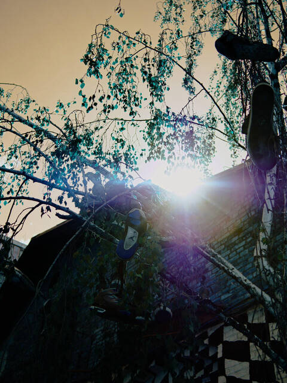<br><b>false colour (red and blue swapped)</b><details><summary>recipe and options</summary><div align="left"><code>falsecolor</code><br><br><code>order=bgr</code> where each channel comes from: <code>rgb</code>, <code>bgr</code>, <code>gbr</code>…<br><code>invert=none</code> channels turned negative: <code>r</code>, <code>g</code>, <code>b</code>, <code>rb</code>… or <code>none</code><br><code>rotate=0</code> turn the hues by this many degrees, -180 to 180<br><code>saturation=100</code> 0 takes the colour out, 100 leaves it, 200 doubles it, up to 400<br><code>only=none</code> move only this hue (a name, degrees or hex); <code>none</code> moves all<br><code>width=30</code> degrees either side of <code>only</code> that are moved whole<br><code>soft=30</code> degrees over which the move fades<br><code>smooth=1</code> how soft the edge of a zone is, in percent of the long side of the picture; the zone is judged on a blurred small copy, so the edge is not a line and a speck of another colour inside it is moved with the rest; 0 judges each pixel alone<br><code>mix=100</code> how much of the result shows over the picture, 0 to 100<br></div></details></td></tr>
<tr><td width="33%" align="center" valign="top">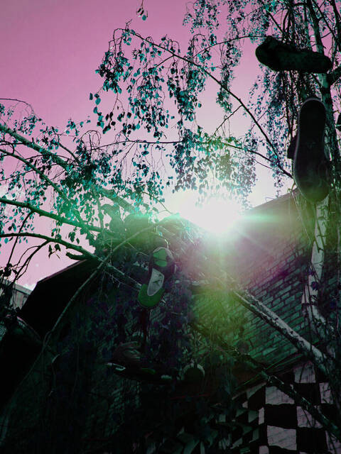<br><b>false colour, hues turned</b><details><summary>recipe and options</summary><div align="left"><code>falsecolor order=rgb rotate=120</code><br><br><code>order=bgr</code> where each channel comes from: <code>rgb</code>, <code>bgr</code>, <code>gbr</code>…<br><code>invert=none</code> channels turned negative: <code>r</code>, <code>g</code>, <code>b</code>, <code>rb</code>… or <code>none</code><br><code>rotate=0</code> turn the hues by this many degrees, -180 to 180<br><code>saturation=100</code> 0 takes the colour out, 100 leaves it, 200 doubles it, up to 400<br><code>only=none</code> move only this hue (a name, degrees or hex); <code>none</code> moves all<br><code>width=30</code> degrees either side of <code>only</code> that are moved whole<br><code>soft=30</code> degrees over which the move fades<br><code>smooth=1</code> how soft the edge of a zone is, in percent of the long side of the picture; the zone is judged on a blurred small copy, so the edge is not a line and a speck of another colour inside it is moved with the rest; 0 judges each pixel alone<br><code>mix=100</code> how much of the result shows over the picture, 0 to 100<br></div></details></td><td width="33%" align="center" valign="top">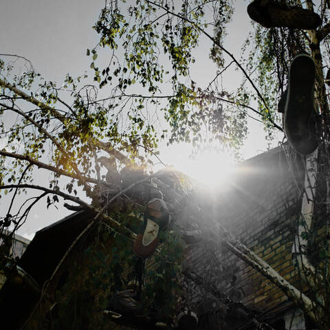<br><b>one point colour</b><details><summary>recipe and options</summary><div align="left"><code>onepoint hue=80deg width=35 soft=30 rest=0</code><br><br><code>hue=0deg</code> the colour kept: a name, degrees or hex<br><code>width=30</code> degrees either side of it that are kept whole<br><code>soft=30</code> degrees over which the colour fades to grey<br><code>rest=0</code> how much colour everything else keeps, 0 to 100<br><code>at=none</code> <code>x,y</code> in percent: take the hue from this point of the picture; <code>none</code> uses <code>hue</code><br><code>smooth=1</code> how soft the edge of the kept zone is, in percent of the long side of the picture; a speck of another colour inside it is kept with the rest; 0 judges each pixel alone<br></div></details></td><td width="33%" align="center" valign="top">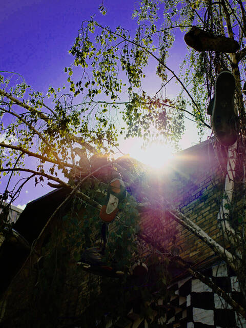<br><b>false colour, only the sky</b><details><summary>recipe and options</summary><div align="left"><code>falsecolor order=rgb rotate=45 saturation=200 only=blue width=25 soft=25</code><br><br><code>order=bgr</code> where each channel comes from: <code>rgb</code>, <code>bgr</code>, <code>gbr</code>…<br><code>invert=none</code> channels turned negative: <code>r</code>, <code>g</code>, <code>b</code>, <code>rb</code>… or <code>none</code><br><code>rotate=0</code> turn the hues by this many degrees, -180 to 180<br><code>saturation=100</code> 0 takes the colour out, 100 leaves it, 200 doubles it, up to 400<br><code>only=none</code> move only this hue (a name, degrees or hex); <code>none</code> moves all<br><code>width=30</code> degrees either side of <code>only</code> that are moved whole<br><code>soft=30</code> degrees over which the move fades<br><code>smooth=1</code> how soft the edge of a zone is, in percent of the long side of the picture; the zone is judged on a blurred small copy, so the edge is not a line and a speck of another colour inside it is moved with the rest; 0 judges each pixel alone<br><code>mix=100</code> how much of the result shows over the picture, 0 to 100<br></div></details></td></tr>
<tr><td width="33%" align="center" valign="top">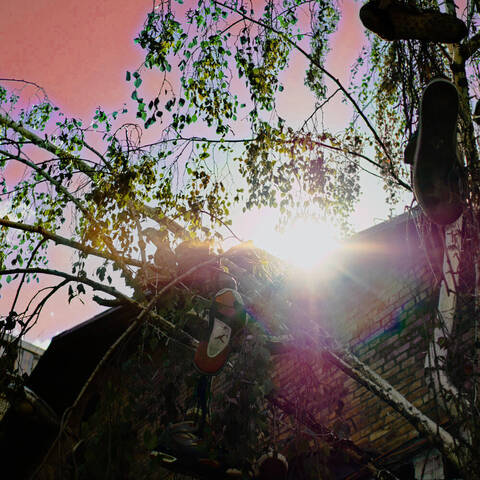<br><b>remap, a hue sent elsewhere</b><details><summary>recipe and options</summary><div align="left"><code>remap map=blue:orange,green:red saturation=130</code><br><br><code>map=none</code> pairs <code>from:to</code> such as <code>blue:orange,green:red</code>, each hue sent to another; up to 8<br><code>width=25</code> degrees either side of a hue that are moved whole<br><code>soft=25</code> degrees over which the move fades<br><code>smooth=1</code> how soft the edge of a zone is, in percent of the long side of the picture; a speck of another colour inside a zone is moved with the rest; 0 judges each pixel alone<br><code>saturation=100</code> strength of the moved colours, 0 to 400; 100 leaves it<br><code>mix=100</code> how much of the result shows over the picture, 0 to 100<br></div></details></td><td width="33%" align="center" valign="top">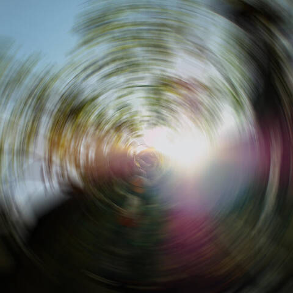<br><b>spin, a turning smear</b><details><summary>recipe and options</summary><div align="left"><code>spin angle=14</code><br><br><code>angle=10</code> how far it turns, in degrees<br><code>center=50,50</code> <code>x,y</code> centre of the turn, in percent of the width and height<br><code>steps=0</code> positions blended; 0 takes as many as each pixel needs, 5 gives separate ghosts<br><code>mix=100</code> how much of the smear shows over the sharp picture, 0 to 100<br></div></details></td><td width="33%" align="center" valign="top">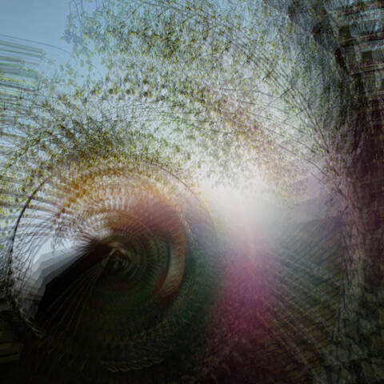<br><b>spin, a few ghosts</b><details><summary>recipe and options</summary><div align="left"><code>spin angle=24 steps=5 center=30,60</code><br><br><code>angle=10</code> how far it turns, in degrees<br><code>center=50,50</code> <code>x,y</code> centre of the turn, in percent of the width and height<br><code>steps=0</code> positions blended; 0 takes as many as each pixel needs, 5 gives separate ghosts<br><code>mix=100</code> how much of the smear shows over the sharp picture, 0 to 100<br></div></details></td></tr>
<tr><td width="33%" align="center" valign="top">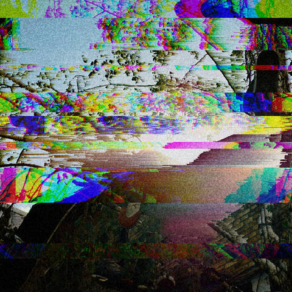<br><b>three effects in a row</b><details><summary>recipe and options</summary><div align="left"><code>sort low=40 high=220 + slice slices=12 split=true + grain</code><br><br>effects joined by <code>+</code> run in order, each with its own options<br></div></details></td><td width="33%"></td><td width="33%"></td></tr>
</table>
<!-- gallery:end -->

An animation mixing five effects: the colours turn from green to violet while slices of the picture are pushed aside, the red and blue edges grow, a faint spin turns round the sun and scanlines stay on top. Parameters written `a..b` go from one value to the other over the animation, and back, so that the loop does not jump (`glitchgif` makes it, `sh docs/examples/generate.sh` makes it again):

<p align="center">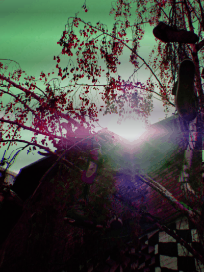</p>

```sh
cargo run --release -p corrode-core --example glitchgif -- docs/examples/photo.jpg glitch-mix.gif frames=14 fps=10 width=400 seed=11 \
    falsecolor order=rgb rotate=-70..70 saturation=130 \
    + slice slices=4..10 shift=10..70 split=true \
    + aberration amount=0.003..0.012 \
    + spin angle=0..2 center=50,45 \
    + scanlines period=3 strength=25
```

## Goals

- Browse a shoot, with or without JPEGs, with 100% zoom to check sharpness
- Rate, color-label and reject photos from the keyboard
- Store marks in RawTherapee `.pp3` sidecars (`Rank`, `ColorLabel`, `InTrash`), no proprietary database
- Open the matching RAW files in RawTherapee
- Sort a selection into folders of shots that look alike (light, colour, time taken)
- Apply a RawTherapee preset to a whole selection, adjusted for each group
- Later: creative glitch effects, live

## Workspace

| Crate | Role |
|---|---|
| `core/` (`corrode-core`) | JPEG↔RAW pairing, `.pp3` sidecars and presets, picture decoding, EXIF, similarity, light bands |
| `effects/` (`corrode-effects`) | The creative effects and their recipes; depends on `image` and `rayon` only, not on the RAW decoder |
| `ui/` (`corrode-ui`) | What the terminal interfaces share: background jobs, terminal graphics, lines that fit |
| `select/` (`corrode-select`) | Culling in the terminal (`ratatui` + `ratatui-image`), the `corrode-select` binary |
| `preset/` (`corrode-preset`) | Applying a RawTherapee preset to a whole selection, group by group |

## Culling

```sh
cargo run --release -p corrode-select -- path/to/shoot
```

corrode shows the shots of a directory one at a time, with the shot's marks and settings on top and a strip of the burst it belongs to below: shots taken less than 300 ms apart. Under each thumbnail are its marks, and ◆ points out the sharpest frame of the burst, measured around the camera's focus point. Marks are written to the RawTherapee sidecars as soon as they are set.

| Key | Action |
|---|---|
| ← → (h l, space, page keys) | Previous / next shot |
| ↑ ↓ ([ ]) | Previous / next burst |
| s | Sharpest frame of the burst |
| k | Keep the current shot, reject the rest of the burst, go to the next burst |
| X | Reject the whole burst, go to the next burst |
| 1–5, 0 (or & é " ' ( à) | Rating, cleared by 0 |
| r y g b p | Red, yellow, green, blue, purple label (again to clear) |
| x, Delete | Reject / restore |
| f | Filter: all, unsorted (left to cull), kept, rejected |
| m | Move the kept shots, whole (JPEG, RAW, sidecars), to a `selection/` folder next to them, to open in RawTherapee; asks first |
| G | Sort the shots of `selection/` into folders of shots that look alike, named after the colour of the light and the first shot (`bleu-IMG_0042`); asks first |
| d / D | Remove the light bands of the RAW into `<name>-deband.dng` next to it, shown once written (D: even when none were found) |
| z, Enter | 100% zoom; arrows then move around, Ctrl+arrows change shot at the same spot to compare |
| + / - | Zoom in (200, 400, 800%) / out |
| o / O | Open the shot / the directory in RawTherapee |
| ? | Full help |
| Esc, q | Leave the zoom / quit |

There is nothing to save: marks are written as they are set. The line above the keys counts kept (✓), rejected (✗) and unsorted (?) shots, and says "all sorted" once nothing is left; quitting prints the same summary. Files are only read, except the sidecars that marks are written to. Directories on a spinning disk are read in the background: bursts take shape around the current shot within seconds to half a minute the first time. What the files told is kept in `~/.cache/corrode` (about 5 KB per shot), so that a directory seen before opens at once; an entry is dropped when its file changes.

## Presets

Sort the selection into groups first, with `G` in `corrode-select`, or without the interface:

```sh
cargo run --release -p corrode-core --example similar -- selection/ --sheets /tmp/sheets   # list the groups, contact sheets to check them
cargo run --release -p corrode-core --example similar -- selection/ --move                 # then sort the shots into folders
```

Then make a preset from one shot in RawTherapee and apply it to every group:

```sh
corrode-preset selection/ --preset my-preset.pp3 --ref selection/reference-shot.RW2            # what would change
corrode-preset selection/ --preset my-preset.pp3 --ref selection/reference-shot.RW2 --save-adjustments adjustments.txt
corrode-preset selection/ --preset my-preset.pp3 --ref selection/reference-shot.RW2 --adjustments adjustments.txt --apply
```

Each folder is a group, and each shot left at the top level is a group of its own. Each group gets the preset with its own exposure compensation, worked out from how light or dark the group is next to the shot the preset was made on (`--ref`). Any other setting can be changed per group in a small file (`[group]`, then `Section.Key=value`). The marks, crop, rotation and white balance of each shot are kept. Nothing is written without `--apply`, and each sidecar is copied to a `.bak` first.

## Effects

The effects turn a picture into something else on purpose: the wear of a compression, the faults of a print or a screen, the colours of another film. A recipe is a few words, `seed=7 sort low=40 + slice split=true`, and the same recipe on the same picture always gives the same result. Every picture of the [gallery](#gallery) comes from [`docs/examples/photo.jpg`](docs/examples/photo.jpg), with `seed=7` and the recipe given in its fold-out:

```sh
cargo run --release -p corrode-core --example effects -- docs/examples/photo.jpg result.jpg seed=7 falsecolor order=rgb rotate=120
```

`effects help` lists the effects and `effects help <effect>` the parameters of one, with their defaults. Sizes are in pixels for a picture 1000 pixels wide and grow with the picture, so a recipe looks the same on a preview and on the full photo. Colours are written `ff4fa3`, by name (`red`, `rouge`, `cyan`…) or as a hue (`210deg`). `sh docs/examples/generate.sh` makes these pictures again from [`recipes.txt`](docs/examples/recipes.txt).

### What each effect does

**Faults of digital files**: what happens to a picture when its data goes wrong.

- `loss` (generation loss): the picture is saved as a JPEG over and over, moved a little each time, as a photo copied and shared a hundred times. Colours bleed and blocks appear.
- `bend` (databending): a few bytes of the compressed file are changed on purpose, then the file is read again. Whole bands of the picture take the wrong colour.
- `sort` (pixel sorting): runs of pixels are put in order from dark to bright, which melts the picture into streaks.
- `slice` (slice shift): horizontal slices are pushed sideways, as on a TV that loses its signal, with their colours coming apart or inverted if asked.
- `stretch` (pixel stretch): a pixel is smeared along its row, or its column, into a long streak.
- `split` (channel split): the red, green and blue of the picture are moved apart, leaving coloured edges, like a badly printed picture.

**Print and screens**: a picture turned into ink or light.

- `dither`: the picture is reduced to black and white dots, as in a fax or a newspaper, either scattered (`diffusion`) or in a regular pattern (`bayer`).
- `duotone`: the picture is printed with two inks, one for the shadows and one for the lights.
- `tritone`: the same with three inks, for the shadows, the mid tones and the lights.
- `scanlines`: dark horizontal lines over the picture, as on an old tube screen.

**Film and light**: what a camera, a lens or a roll of film does by accident.

- `drag`: a flash on a slow shutter. The picture stays sharp and a trail of light follows it, sideways (`motion`) or from the centre (`zoom`).
- `aberration`: the lens does not focus all colours at the same place, so red and blue edges grow towards the corners.
- `grain`: the speckle of fast film.
- `fade`: the look of an old print, with the blacks lifted, the colours washed and a warm tint.
- `vignette`: the corners get darker.
- `leak`: a coloured glow comes in from an edge, as if light had reached the film.
- `bloom`: the brightest lights glow, with a halo around them.

**Distortion**: the picture is moved, not recoloured.

- `liquid`: waves run through the picture, as if seen through moving water.
- `spin`: the picture is smeared round a point, as if the camera had turned during the shot; with a few steps, it leaves separate ghosts.

**Colour**: the colours moved on purpose.

- `falsecolor`: the colours are swapped or turned round the colour wheel (red and blue swapped is the look of infrared film). It can make the colour stronger, and be limited to one range of colours so that the rest stays as it was.
- `remap`: several colours each sent their own way at once, such as the sky towards violet and the grass towards red, without one change feeding another.
- `onepoint` (one point colour): one colour is kept and everything else goes grey, as a yellow that stays vivid in a black and white picture.

## Core library

| Module | What it does |
|---|---|
| `pairing` | Groups the JPEG and RAW files of a directory into shots, by base name |
| `marks` | The rating, color label and rejection culling sets on a shot |
| `pp3` | Reads and writes a RawTherapee sidecar: the marks, any key, a whole section; every other byte is kept |
| `rawtherapee` | Reads RawTherapee's settings, picks a shot's sidecar, creates it from the default profile, opens RawTherapee |
| `exif` | Date to the millisecond, exposure, aperture, ISO, focal length, camera, lens and focus point, from the head of a file |
| `picture` | Decodes a shot upright: its thumbnail, the preview embedded in the JPEG or the RAW, or the full image |
| `formats` | What a TIFF structure, a JPEG and a RW2 file hold and where, without decoding |
| `cameras` | What is specific to a make: the Panasonic focus point and its orientation quirk |
| `cache` | Keeps the shooting information and thumbnails between sessions, one file per directory |
| `bursts` | Groups shots taken in quick succession |
| `selection` | Moves the kept shots, with their sidecars, to the shoot's `selection/` folder, then sorts them into subfolders by group |
| `similarity` | Tells how much shots look alike (colour, layout, light, time taken), groups them and names the colour of each group's light |
| `look` | Puts the look of a reference profile on other profiles, keeping the marks, framing and white balance of each shot |
| `preset` | Applies a preset to the groups of a selection, with an exposure and settings of their own for each |
| `sharpness` | Scores the sharpness of a picture around its focus point |
| `banding` | Detects the light bands LED lighting leaves with an electronic shutter |
| `debanding` | Removes those bands from the raw sensor data, per color, by their period |
| `dng` | Writes a raw image as a DNG with the original's metadata and preview |

### Trying it

The examples work on a directory of photos. Copy a few shots to `sandbox/`, which git ignores, rather than working on the originals:

```sh
cargo run -p corrode-core --example scan -- sandbox --list                 # how files are paired
cargo run --release -p corrode-core --example info -- sandbox              # marks and shooting information
cargo run -p corrode-core --example marks -- set --rank 4 sandbox/photo.JPG
cargo run --release -p corrode-core --example picture -- sandbox/out sandbox/*.JPG
cargo run --release -p corrode-core --example bursts -- sandbox --list
cargo run --release -p corrode-core --example similar -- sandbox --sheets sandbox/out   # groups of similar shots
cargo run --release -p corrode-core --example sharpness -- sandbox
cargo run --release -p corrode-core --example banding -- sandbox          # which shots have light bands
cargo run --release -p corrode-core --example deband -- sandbox/banded-shot.RW2   # remove them, into a DNG
```

`marks set` writes the RawTherapee sidecars of the shots it is given. `picture` saves the decoded pictures in the output directory. Use `--release` for decoding: it is much slower in debug builds.

## Requirements

- Linux, a terminal supporting the Kitty or Sixel graphics protocol (e.g. kitty)
- [RawTherapee](https://rawtherapee.com/), configured to save `.pp3` files next to the input files

## License

Licensed under either of [Apache License 2.0](LICENSE-APACHE) or [MIT license](LICENSE-MIT), at your option.
